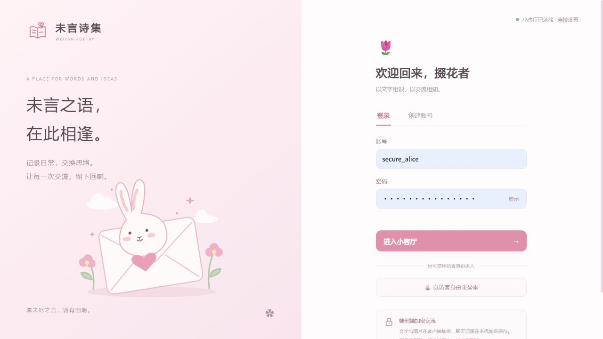
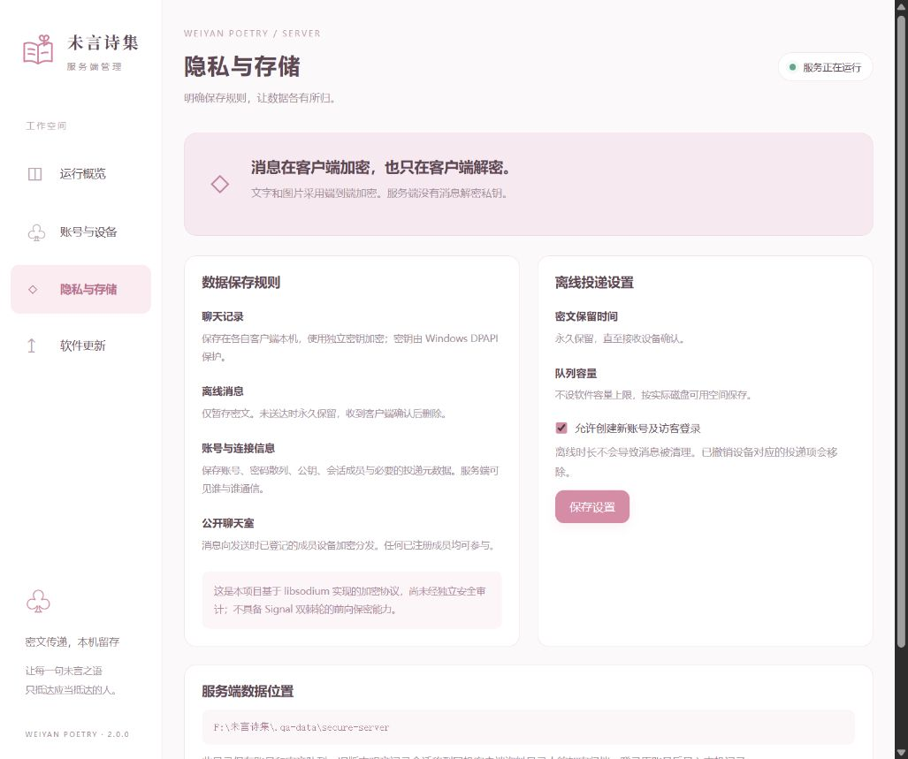

# 未言诗集

浅粉色主题的 Windows / Android 聊天软件，提供 Apple Silicon Mac 与 Windows 服务端。客户端、服务端独立运行，服务端有自己的图形管理窗口。





## 下载与使用

在 [Releases 下载页面](https://github.com/XJhejin/weiyan-poetry/releases/latest)选择安装包：

| 用途 | 安装包 | 安装方法 |
| --- | --- | --- |
| Windows 客户端 | `weiyan-client-2.1.1-windows-x64.msi` | 双击安装，自动添加桌面和开始菜单快捷方式 |
| Android 客户端 | `weiyan-client-2.1.1-android.apk` | 手机下载后通过系统安装器安装 |
| Apple Silicon Mac 服务端 | `weiyan-server-2.1.1-macos-arm64.dmg` | 打开后将应用拖到 Applications |
| Windows 服务端 | `weiyan-server-2.1.1-windows-x64.zip` | 完整解压，双击服务端 exe |

Windows 客户端也提供便携 ZIP。ZIP 中的 `_internal` 必须与 exe 一起保留。所有安装包包含运行库，不需要安装 Python。

Mac 应用仅作临时签名，尚未经过 Apple Developer ID 公证；首次打开时需在系统设置「隐私与安全性」确认来源。

客户端默认连接 **`http://113.219.237.106:23074`**，之前保存的自定义连接地址会保留。该地址需要实际运行服务端并开放/转发端口；本项目发布安装包不会自动部署远程服务器。同机测试请在客户端连接设置填入 `http://127.0.0.1:23074`。

启动服务端后，在客户端创建账号或以访客进入；不同设备连接同一服务端即可交流。

## 与另一台电脑聊天

1. 选一台电脑运行服务端，在“运行概览”中复制局域网连接地址。
2. 在另一台电脑解压并运行客户端，点击登录页右上角“连接设置”，填写该地址。
3. 两人各用自己的账号进入，可以在公共聊天室聊天，也可点击“+”搜索账号并开启私聊。

局域网连接时，两台设备需处于同一局域网。默认端口为 TCP 23074；服务端支持选择仅本机或局域网监听。跨互联网使用需要单独部署 HTTPS 反向代理，软件不会自动提供公网服务器。

## 加密与记录

- **文字、图片、视频和文件端到端加密**：在发送设备加密，在接收设备解密，服务端不持有消息解密私钥。
- **本机加密保存**：聊天记录、草稿、收藏、图片、视频、文件和待发内容均在客户端本机加密保存，私钥与本机密钥由 Windows DPAPI 或 Android Keystore 保护。
- **离线密文永久待投递**：服务端仅保存待投递密文，不设到期时间，也不设队列总容量上限；接收设备确认写入本机后删除。实际可用存储取决于服务端磁盘空间。
- **查看加密状态**：聊天页顶部“端到端加密”、输入栏加密标识、登录页与“设置→加密与隐私”均有说明。
- **设备指纹**：首次联系会记住设备公钥；新增或更换设备时暂停信任变化设备，需通过可信渠道核对安全指纹并确认。
- **换电脑不迁移旧记录**：新设备只能收到登记以后发给它的消息；卸载或丢失本机密钥无法通过服务器找回旧记录。
- **公开聊天室**：所有已注册成员均可参与，发送时已登记的成员设备可以解密该条消息。
- **服务端仍可见元数据**：账号、设备公钥、会话成员、连接与投递时间等；加密不隐藏通信关系。

本项目基于 libsodium 实现加密协议，尚未经过独立安全审计，也不具备 Signal 双棘轮协议的前向保密能力。聊天加密不代替 HTTPS 对登录凭据与元数据的保护。

## 服务端管理

- **运行概览**：启动/停止服务、监听范围和端口、连接地址、在线用户与设备、待投递密文数量。
- **账号与设备**：搜索成员、启用/停用账号、使账号退出登录、撤销丢失的加密设备。
- **隐私与存储**：查看永久待投递与无队列容量限制的规则，配置是否开放账号及访客注册。
- **软件更新**：从本项目 GitHub Releases 检查、下载和安装服务端更新。

管理接口只绑定本机回环地址，并要求本次窗口的随机管理凭据与来源校验；不会随聊天端口开放到局域网。管理界面不提供聊天正文查看或解密功能。

## 日常操作

- Windows Enter 发送、Shift + Enter 换行；Android Enter 换行，点击发送按钮发送。支持中文输入法、表情、图片与粘贴图片。
- 支持文件和视频发送、发送前视频预览、聊天内播放与下载；可将图片、视频或文件拖到输入区域。图片最大 5 MB，文件/视频每项最大 20 MB，一条消息选择一项附件。
- 公共房间仅「-扉页-」。搜索支持 @用户名精确查找或昵称搜索；结果提供「私聊」「添加好友」。好友需要对方同意，陌生人私聊顶部显示提示与加好友按钮。
- 群聊支持邀请与接受、群主/管理员、踢出、群名称/头像/公告、群昵称、禁言、群主转让、退群和解散。管理员不能移除群主，只有群主能分配管理员。
- Windows 关闭窗口后继续在右下角托盘运行；点击图标打开，托盘菜单可彻底退出。后台新消息显示通用加密消息提醒，可关闭提醒。
- Android 首次使用请求通知权限；可见的前台服务维持后台收取，通知中可停止后台接收。系统省电、强行停止或清理可能中断服务，重新打开后补收；未接入厂商云推送。
- 右键消息可回复、复制和收藏；右键会话可置顶、免打扰。搜索只在当前设备已保存的记录中进行。
- 连接中断后自动重连，消息编号、应答与重传去重避免重复显示。未成功送到服务器的内容留在本机，可重试。
- 单勾表示已加密发送并得到服务端确认；“已读”表示对方阅读。未送达密文一直保留，直到接收设备确认。
- 点击左下角头像修改资料。访客应先设置正式账号与密码，再退出登录。

## 软件更新

客户端“设置→软件更新”或登录页底部“检查更新”；服务端左侧“软件更新”。

页面显示当前版本、GitHub 正式版本、更新说明和下载进度。更新包先通过 **Ed25519 发布签名 + SHA-256** 校验。Windows 便携版由辅助程序替换并在失败时回滚；MSI 交由 Windows Installer 升级与回滚；Android 还核对应用 ID、版本与固定签名证书，再交由系统安装器确认；Mac 挂载已校验 DMG，校验应用签名后替换应用并保留旧应用备份。用户资料位于安装包之外。

2.1.1 增加 Windows 更新助手启动与验签自检，失败时保留当前程序运行。如果旧版更新时出现 `No module named '_cffi_backend'`，请从 Releases 下载 2.1.1 的 MSI，退出客户端后双击安装一次；原 Windows 账号下的聊天资料与连接设置会保留。不要卸载安卓旧版再安装，新 APK 使用相同证书，可直接覆盖升级。

## 数据位置与备份

- 客户端：`%LOCALAPPDATA%/WeiyanPoetry/client/`，`secure/` 中保存加密记录与密钥。
- Windows 服务端：`服务端/data/weiyan.sqlite3`。Mac 服务端：`~/Library/Application Support/WeiyanPoetry/server/`。保存账号、公钥、会话成员与待投递密文，不保存聊天正文历史。
- Android 客户端：应用私有空间，Vault 主密钥由 Android Keystore 保护；卸载将删除本机资料，自动云备份已禁用。
- 旧版升级：原明文记录会迁移为客户端资料目录 `legacy/` 下的 DPAPI 加密归档，随后删除服务端旧消息表和上传文件，并压缩清理数据库。原账号在同机客户端登录时导入自己的记录。请使用原 Windows 账号。
- 备份时先退出软件，分别复制完整客户端资料目录与服务端 data。**DPAPI 资料不能保证在另一台电脑或另一 Windows 账号解锁**，仅复制 exe 不包含聊天记录。

## 运行环境与开发

Windows 10/11 x64，Microsoft Edge WebView2 Runtime；Android 7.0+（ARM64 或 x86_64，需可用的系统 WebView）；macOS 12+ Apple Silicon 服务端。程序打包包含 Python 运行库。安卓测试覆盖 API 35 的 4 KB 页设备，16 KB 页设备兼容性尚未验证。

源码开发使用 Python 3.12，分别安装两个目录中的 requirements.txt；运行 `python 服务端/server.py` 和 `python 客户端/main.py`。无界面服务模式：`python 服务端/server.py --headless`。

```powershell
python 服务端/tests/test_chat.py
python 服务端/tests/test_privacy_tools.py
python -m pip install -r 客户端/tools/requirements.txt
python 客户端/tools/build.py
python 客户端/tools/build_msi.py --wix .build/wix/wix.exe
$env:WEIYAN_TEST_BINARIES='1'
python 服务端/tests/test_chat.py
```

通信管理参考 HarmonyChat 的心跳、重连、消息指纹、ACK 与重传去重原理；界面、Windows 软件与加密存储为独立实现，不兼容 MobileIMSDK 协议。详见 [技术说明](技术说明.md)。

Android 构建使用 JDK 17、Gradle 8.10、SDK 35：在 `客户端/android` 运行 `gradle :app:assembleRelease`。维护者使用 `客户端/tools/sign_apk.py` 固定证书签名，签名资料保存在项目外。Mac 构建在 ARM64 macOS 运行 `python 服务端/tools/build_macos.py`。三个平台的 CI 构建与实际运行测试见 `.github/workflows/`。正式发布使用 `客户端/tools/publish.py`，要求五个包齐备并生成统一签名清单。

Windows 托盘有未读时整枚 Logo 交替显示与隐藏，悬停显示最新发送者与消息预览，打开客户端后停止；图标暂时透明时仍可点击。系统弹窗通知保持通用提示。托盘是否收进折叠菜单由 Windows 决定；在客户端“设置 → 托盘图标常驻 → 前往设置”中打开任务栏设置，开启“未言诗集”，或将图标从折叠菜单拖到任务栏。软件保留系统记住的显示位置，不修改全局托盘设置。界面弹窗与按钮采用短暂渐变/缩放，遵循系统减少动态效果设置。Windows 原生窗口开合也采用渐变。

个人头像：点击左下角头像或“设置 → 编辑资料 → 选择图片”，拖动、缩放后选择“使用此头像”，再保存资料。群头像使用同样的裁剪方式，由群主与管理员修改。支持不超过 10 MB 的 PNG、JPEG、WebP 原图，裁剪为 256×256；服务端重新解码、移除附带信息并保存规范化头像。头像属于服务端可见的公开资料，聊天正文和附件仍按端到端加密处理。管理页“账号与设备”提供头像预览与重置操作。
